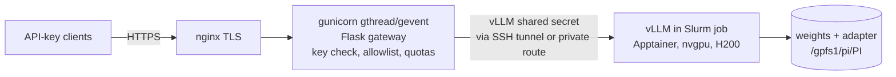

# Deploying a fine-tuned gpt-oss-120b on the VACC (vLLM + Flask gateway)

Compiled 2026-11-13 from primary sources. This page indexes four notes and pulls out what decides the deployment. The citations are in the notes, not here. VACC background is in [../vacc/README.md](../vacc/README.md).

| Note | Covers |
| --- | --- |
| [../vacc/serving-an-llm.md](../vacc/serving-an-llm.md) | VACC/UVM policy, networking, the 48 h walltime, hosting alternatives, CU cost, data classification, draft email to vacchelp |
| [vllm-gpt-oss-120b.md](vllm-gpt-oss-120b.md) | Model facts, memory sizing, kernels per VACC GPU, fine-tune formats, `vllm serve` flags, Apptainer, sbatch sketch |
| [test-box.md](test-box.md) | Local RTX 3080 test box (2026-11-20): Rocky 9, NVIDIA driver, Apptainer 1.3.4, vLLM SIF + stand-in LoRA, llama.cpp gpt-oss-20b, single-node Slurm 25.11.2, nginx/valkey gateway side; install + verify steps per component |
| [flask-gateway-and-security.md](flask-gateway-and-security.md) | vLLM endpoint exposure, security advisories, API-key design, SSE streaming through gunicorn/nginx, gateway placement, code sketch, checklist |

## Target architecture

Whiteboard: [architecture.excalidraw](architecture.excalidraw), generated from [architecture.mmd](architecture.mmd). Edit the `.mmd` and rerun the `to-whiteboard` converter, because hand edits to the `.excalidraw` are overwritten on the next run. The green "Component guide" frame explains each piece. Its boxes link to primary docs through the `.mmd`'s `click` lines, which become Excalidraw links: open them from the link icon on each box.

Live notes board for the project (shared Excalidraw room, separate from the generated `.excalidraw` file): https://excalidraw.com/#room=e502e9292837b1627005,gKfhUyEqcwbmAt0t8KvyLw

The gateway runs off the GPU node (Silk or an ETS research VM; login nodes are not allowed). vLLM is never reachable by end users.

## Decisions that follow from the evidence

1. **Choose the GPU by fine-tune format, not by guesswork.**
   - LoRA adapter on the MXFP4 base: **1× H200, TP1** (`--constraint=GPU_SKU:H200`). It works with `--enable-lora`, but that forces the slower Marlin MoE kernel. LoRA at TP4/TP8 gives wrong results in vLLM ≤ 0.33.0 (fixed by PR #65825, which is not yet in a release).
   - Full or merged fine-tune in BF16 (about 234 GB): **4× H200, TP4**, with `H200_SXM` preferred. No published vLLM recipe serves gpt-oss-120b in BF16, so smoke-test it first.
   - Best serving efficiency: QAT back to MXFP4 with NVIDIA Model-Optimizer, then 1× H200 on the default fast path.
   - RTX Pro 6000 runs the model but is not on vLLM's verified list. A100 40 GB does not fit. The H100s are owner-restricted.
2. **vLLM's `--api-key` is not user auth.** It covers only `/v1`, `/v2`, `/inference` and `/cohere`. `/invocations`, `/pause` and `/update_weights` stay open. With no `--host`, vLLM binds **all interfaces** (checked in v0.33.0 source; the legacy recipe's "127.0.0.1" claim is wrong). Pass `--uds` in a 0700 directory, or `--host 127.0.0.1` on an `--exclusive` node. Use `--api-key` only as a secret shared between the gateway and vLLM.
3. **The Flask gateway owns user keys.**
   - Store `HMAC-SHA256(pepper, key)` and compare with `hmac.compare_digest`.
   - Allowlist `/v1/chat/completions` and `/v1/models`, plus the request fields.
   - Set `model`, the token cap and a per-user `cache_salt` on the server.
   - Force `stream_options.include_usage` so streamed tokens can be metered.
   - Strip or disable reasoning with `include_reasoning: false`.
   - Avoid `/v1/responses` for metering: its usage counts are all zeros.
4. **Use vLLM ≥ 0.33.0**, because 0.33.0 fixes many request-field DoS bugs and an API-key bypass through the `Host` header (fixed in 0.22.0). Its image is CUDA 13 only, which needs an R580+ host driver or compat mode. Run `nvidia-smi` in a GPU job to check the driver.
5. **Uptime is limited by Slurm, not the model.** `nvgpu` caps jobs at 48 h, so a 24/7 service needs about 183 hand-offs a year. Use overlapping relay jobs (`--dependency=after:<id>+2820`), or ask VACC for a reservation, a QOS or condo nodes. No SLA exists, and maintenance windows (next 2027-01-05) take the service down.
6. **Cost is a flat tier fee.** One GPU running all year comes to 525,600 CU (Tier 2, $1,000). One GPU for a 15-week semester fits in free Tier 1. Four GPUs all year is still Tier 2.
7. **Approval first.** UVM's Data Classification Matrix says individuals or groups need "formal approval" to run a network-accessible server. AUP §4.b.ix ("allowing others to use") also applies. The data class of user prompts conflicts between sources: VACC is Low-only in the Matrix but Low–Moderate on the AI tools page, and non-health FERPA data is Moderate.

## Blocking unknowns (send before building)

Send the draft email in [serving-an-llm.md § Who to contact](../vacc/serving-an-llm.md#who-to-contact-and-a-draft-email). Its answers decide the architecture:

- whether VACC permits a persistent service, and whether `week` or a reservation offers GPUs beyond 48 h;
- the network path from a campus host to a compute node: inbound route, `AllowTcpForwarding`, SSH keys, Duo;
- whether SSH into a running job's node is allowed, which the `--uds` tunnel depends on;
- the host NVIDIA driver version and the per-job `/dev/shm` size;
- server approval and prompt data class from iso@uvm.edu.

## Things to measure once a job runs

- Marlin (LoRA) against the Triton MoE kernel on H200: `vllm bench serve`.
- Adapter on the MXFP4 base against the merged BF16 model: `python -m gpt_oss.evals`. vLLM's published reference scores for the base model are low effort GPQA 65.3 / AIME25 51.2.
- Whether gunicorn detects client disconnects mid-stream, so vLLM cancels the request.
